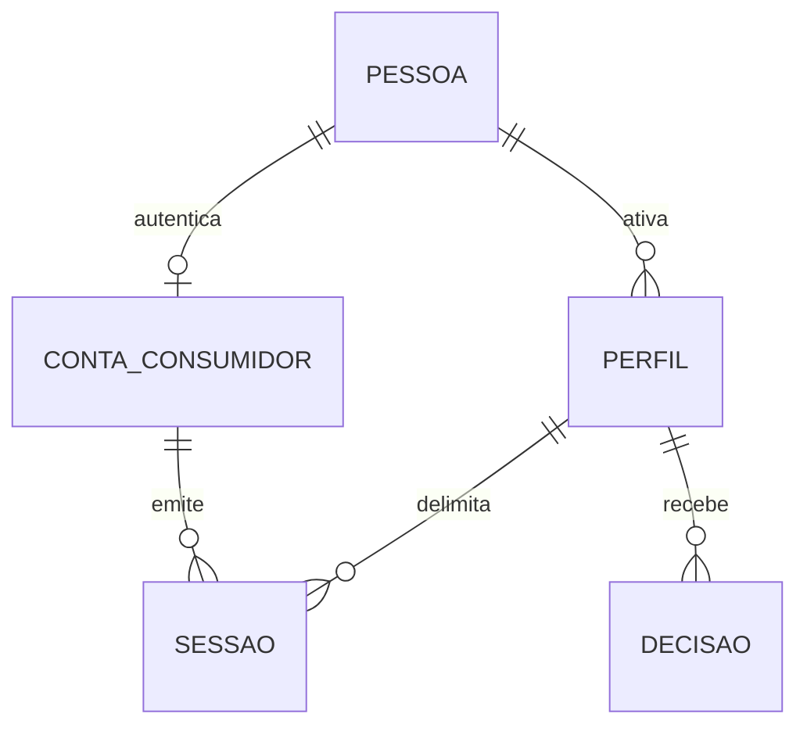

# Identidade FAIRGO — estudo para decisão

A proposta separa pessoa, credenciais de consumidor, perfis de produto e permissões. Hoje usuarios tem UUID, e-mail único, um perfil e uma situação. contas_driver tem CPF único no conjunto Driver, celular sem unicidade e indicadores de verificação. O UUID existente ancora documentos, veículos, decisões e histórico. credenciais_admin possui ciclo separado.

## Relacionamentos propostos

Cada sessão referencia conta e perfil da mesma pessoa. O servidor deriva o titular, verifica o aplicativo, o estado da conta e do perfil e a propriedade do recurso em cada operação. A ativação de Passenger segue seus requisitos próprios. Aprovação Driver, suspensões e histórico ficam no perfil correspondente. Uma suspensão global justificada bloqueia acesso de consumidor em ambos os aplicativos e revoga suas sessões. Uma suspensão local bloqueia operações e sessões daquele perfil. Registrar motivo, autoridade, instante, abrangência e revisão. O efeito sobre consulta de situação ou recurso administrativo exige decisão de produto.

## Opções de autenticação

1. **Conta compartilhada com sessões por aplicativo** é a opção preferida para estudo. Uma credencial facilita o segundo cadastro. Comprometimento ou recuperação passa a afetar os dois perfis. Redefinir a senha comum deve revogar todas as sessões da conta em uma operação atômica, protegida contra login concorrente. A ativação adicional exige autenticação recente e verificação dos requisitos do perfil. Cada aplicativo recebe sua própria sessão.
2. **Contas por aplicativo vinculadas a uma pessoa** reduzem o alcance de uma credencial comprometida e permitem recuperação por produto. Aumentam o custo de suporte, vínculo e troca de contatos. A redefinição revoga sessões da conta afetada. Suspensão global exige coordenação entre contas.

## Matriz conceitual de permissões

| Operação | Sessão Driver | Sessão Passenger | Admin autorizado |
|---|---|---|---|
| Consultar dados do próprio perfil | Driver próprio | Passenger próprio | Conforme função e finalidade auditada |
| Enviar evidências ou alterar veículo | Driver próprio habilitado para a operação | Negado | Apenas operações administrativas previstas |
| Operar como passageiro | Negado | Perfil próprio ativo | Negado |
| Aprovar cadastro ou aplicar suspensão | Negado | Negado | Permissão específica e histórico |
| Acessar credenciais ou tokens de outro perfil | Negado | Negado | Negado |

Credenciais administrativas mantêm emissão, autorização e revogação próprias. Em uma conta compartilhada, alteração de e-mail exige prova e invalidação dos vínculos de recuperação antigos. Preservar respostas públicas uniformes e evitar revelar a existência do outro perfil.

## Migração e privacidade

Inventariar UUIDs, FKs, colisões de e-mail normalizado e cadastros administrativos sem conta. Preservar UUIDs públicos, vínculos e contexto criptográfico documental. Projetar criação aditiva de perfis com preenchimento idempotente, validar contagens, autoria, integridade e leitura documental em cópia restaurada. Ensaiar troca de leitura e reversão antes de retirar o modelo anterior. Manter o perfil original até validar cada correspondência. Divergências vão para análise com comprovação de titularidade. Coincidência de CPF, telefone ou e-mail isolada não autoriza fusão. Planejar explicitamente sessões vigentes, desafios, gatilhos de desverificação e recuperação.

Compliance deverá avaliar finalidade, necessidade, base legal, retenção, acesso e transparência por produto. Manter CNH, análise de identidade e decisões do Driver restritas aos usos autorizados. Recharge depende de definição do controlador e das finalidades antes de qualquer vínculo ou acesso. Permanecem em decisão o alcance da conta comum, os critérios de suspensão global e o procedimento de recuperação quando o contato foi perdido. [Referência de Compliance](compliance/README.md)
